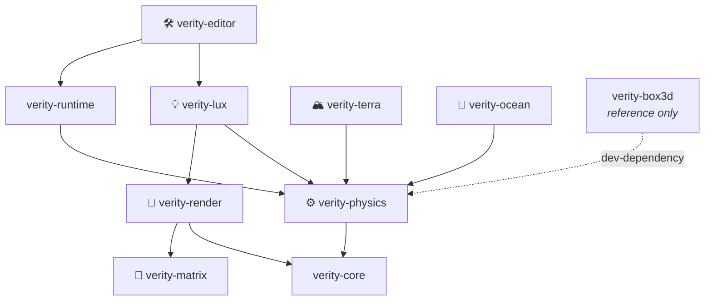

<div align="center">

# ✨ Verity Engine

**A Rust game engine where every system is measured against a reference.**

Vulkan renderer · AVBD physics · real-time global illumination · virtual geometry · destructible terrain · ocean

[](https://www.rust-lang.org/)
[](https://www.vulkan.org/)
[](https://shader-slang.org/)
[](#-license)
[](#-status)

[Features](#-features) ·
[Benchmarks](#-benchmarks) ·
[Quick start](#-quick-start) ·
[Examples](#-examples) ·
[Architecture](#%EF%B8%8F-architecture) ·
[Documentation](#-documentation)

</div>

---

## 🧭 Why Verity?

Most engines tell you a feature exists. Verity tells you **how close it is to the right answer**:

- 🎯 **Physics** is checked against closed-form results (stopping distances, rolling, tumbling, pendulums) and benchmarked head-to-head with [Box3D](https://github.com/erincatto/box3d).
- 💡 **Global illumination** is scored against a path-traced reference for error *and* flicker.
- 🌲 **Virtual geometry** is compared pixel for pixel with drawing every triangle.
- 📓 **Every optimization**, kept or rejected, is written up with numbers in a [public lab notebook](crates/verity-physics/PERFORMANCE.md).

## 🚀 Features

<table>
<tr>
<td width="50%" valign="top">

### ⚙️ Physics: `verity-physics`
- **AVBD** solver (Augmented Vertex Block Descent), written from scratch
- Speculative contacts: no tunnelling, even at 150 m/s
- Breakable joints with steel, wood, rubber, bone and ligament presets
- Hill muscles and per-axis rotation limits
- FEM cloth that tears, solids that dent and crack
- Deformable car bodies, calibrated to crash tests and skinned on the GPU
- AVX2 / AVX-512 SIMD, **bit-identical** on every CPU and thread count

</td>
<td width="50%" valign="top">

### 💡 Global illumination: `verity-lux`
- **Split Radiance Cascades** with multi-bounce
- **PXTGI**: traces the *physics* scene, so sleeping bodies cost nothing
- **Screen + voxel GI**: the fastest, at about 1.6 ms
- Path-traced reference mode for measuring error
- Follows terrain edits live

</td>
</tr>
<tr>
<td valign="top">

### 🌲 Virtual geometry: `verity-matrix`
- Cluster LOD DAG built with meshoptimizer
- Voxelized foliage that survives simplification, as in Nanite Foliage
- Hemi-octahedral imposters with parallax
- LOD selected on the GPU, with a fixed draw count however big the scene
- **2,500 trees × 20,000 leaves in 1.7 ms**

</td>
<td valign="top">

### 🏔️ Terrain: `verity-terra`
- Stream-power river erosion, droplets and thermal slumping
- Editable 3D density field: dig real caves and overhangs
- Surface Nets meshing on worker threads
- Physics collides with the field itself, so edits apply instantly
- Seeds reproduce the same terrain on any thread count

</td>
</tr>
<tr>
<td valign="top">

### 🎨 Rendering: `verity-render`
- Vulkan renderer with Slang shaders
- Visibility buffer and GPU frustum and occlusion culling
- 1,024 point lights, cascaded sun shadows
- Procedural terrain shading, retained GPU meshes

</td>
<td valign="top">

### 🌊 Water: `verity-ocean`
- FFT ocean spectrum cascades
- Ripples and shallow-water simulation
- Shore breakers with a parametric breaking profile

### 🛠️ Editor: `verity-editor`
- Gizmos, inspector, outliner and asset browser
- Play mode with live physics and joint loads

</td>
</tr>
</table>

## 📊 Benchmarks

### ⚙️ Physics vs Box3D

Single thread on a Ryzen 7 8845HS. Each figure is **Box3D's time ÷ Verity's**, so higher means Verity is faster.

| Scene | Active (first 60 steps) | Full run (300 steps) |
| --- | :---: | :---: |
| 🧱 Pyramid, 210 boxes | 🟢 **1.30×** | 🟢 **1.67×** |
| 🧱 Pyramid, 820 boxes | 🟢 **1.14×** | 🟢 **1.99×** |
| 🌧️ Rain, 512 bodies | 🟢 **1.39×** | ⚪ 1.01× |
| 🌧️ Rain, 2,744 bodies | 🟢 **1.43×** | ⚪ 0.96× |

**Accuracy** against closed-form references (lower is better unless stated):

| Test | Reference | Verity | Box3D |
| --- | :---: | :---: | :---: |
| Cube dropped 5 m, peak penetration | 0 m | 🏆 **0.0000** | 0.0906 |
| Head-on at 20 m/s, peak overlap | 0 m | 🏆 **0.0000** | 0.3333 |
| Pile, peak floor penetration (8 seeds) | 0 m | 🏆 **0.0202** | 0.1113 |
| Pile, late body overlap (8 seeds) | 0 m | 🏆 **0.0048** | 0.0327 |
| Stack of 20, top height | 19.5 m | 🏆 **19.467** | 19.394 |
| Tumbling slab, energy kept | 1.0 | 🏆 **1.0000** | 0.9830 |
| Box sliding across floor tiles | ±5% of theory | 🏆 ✅ | ❌ catches on seams |
| Slide stop at 5 m/s | 2.1237 m | −2.5% | 🏆 **−0.5%** |
| Momentum kept by a 20 m/s strike | 20 | 19.73 | 🏆 **20 (exact)** |

<details>
<summary><b>📐 How these were measured</b></summary>

<br>

- `compare` alternates five runs per engine for each scene and reports medians. It checks body counts, finite transforms, heights, final floor penetration, RMS speed and, for the heavy stack, body-to-body overlap.
- *Active* is the first 60 steps while everything moves; *full* is all 300 steps, including settling and sleep. Look at both.
- The two engines use different solvers, so the timings are not quality-matched. Ratios within about 5% are noise.
- AVX-512 builds of the same kernels are another 1–5% faster.
- Results are bit-identical across AVX-512, AVX2 and the scalar fallback, and across 1, 4 and 8 threads.
- Box3D is a **reference only**: no Verity crate depends on it.

```bash
RAYON_NUM_THREADS=1 cargo run --release -p verity-physics --example compare
```

```bash
cargo run --release -p verity-physics --example quality
```

Focus a workload with `VERITY_SCENE=pyramid`, `rain`, `slide`, `free_slide` or `heavy`, and experiment with `VERITY_ITERATIONS` and `BOX3D_SUBSTEPS`. Lower counts can change stability and sleep behaviour, so compare simulation quality as well as time before changing defaults.

For a local benchmark, `RUSTFLAGS="-C target-cpu=native"` may improve code generation, but the binary may not run on other machines.

</details>

### 💡 Global illumination vs a path tracer

Sponza at 1280×720 on an RTX 4070 Laptop GPU. Error is the mean absolute difference from the path-traced reference, as a fraction of its bounced light.

| View | Method | GPU time | Error | Flicker |
| --- | --- | :---: | :---: | :---: |
| 🏛️ Atrium | Split Radiance Cascades | 11.7 ms | 0.36 | **0.002** |
| 🏛️ Atrium | PXTGI | 3.8 ms | **0.28** | 0.006 |
| 🏛️ Atrium | Screen + voxel | **1.8 ms** | 0.29 | 0.004 |
| 🚪 Corridor | Split Radiance Cascades | 5.7 ms | 0.20 | **0.002** |
| 🚪 Corridor | PXTGI | 3.2 ms | **0.07** | 0.013 |
| 🚪 Corridor | Screen + voxel | **1.6 ms** | 0.30 | 0.010 |

### 🌲 Virtual geometry

RTX 4070 Laptop at 1600×900:

| Scene | Matrix | Every triangle | Speed-up |
| --- | :---: | :---: | :---: |
| 🌳 Forest: 2,500 trees × 20,000 leaves | **1.7 ms** | 209 ms | **~123×** |
| 🏛️ New Sponza | **8 ms** | 63 ms | **~8×** |

Both are within 0.3/255 of the exact image.

## ⚡ Quick start

**Requirements:** Rust (2024 edition), the Vulkan SDK, and the [Slang](https://shader-slang.org/) compiler (`slangc` on `PATH`, or set `SLANGC`).

```bash
git clone https://github.com/HyperExtendedReality/Verity.git
```

```bash
cd Verity
```

Launch the editor:

```bash
cargo run --release -p verity-editor
```

Fly over an eroded island and dig into it, with GI:

```bash
cargo run --release -p verity-lux --example terrain -- --landform island --seed 7 --gi pxtgi
```

> [!TIP]
> In the editor, open `assets/scenes/physics-playground.verity` from the Asset Browser and press **Play**. Try `joints.verity` and `soft-bodies.verity` too.

> [!NOTE]
> To build or test the workspace without the Box3D reference, exclude it:
> `cargo test --workspace --exclude verity-box3d --exclude verity-physics`

## 🎮 Examples

| Example | Command |
| --- | --- |
| 🏔️ Diggable terrain with GI | `cargo run --release -p verity-lux --example terrain` |
| 💡 Sponza GI with a path-traced reference | `cargo run --release -p verity-lux --example sponza_gi -- --reference` |
| 🧪 PXTGI physics room | `cargo run --release -p verity-lux --example pxtgi_room` |
| 🌲 Virtual geometry forest | `cargo run --release -p verity-render --example forest -- --debug` |
| 🧵 Cloth and soft bodies | `cargo run --release -p verity-render --example soft_bodies` |
| 🚗 Deformable cars | `cargo run --release -p verity-render --example embedded_cars` |
| 🌊 Shore breakers | `cargo run --release -p verity-render --example shore_breakers` |
| 📊 Physics vs Box3D, speed | `cargo run --release -p verity-physics --example compare` |
| 🎯 Physics vs Box3D, accuracy | `cargo run --release -p verity-physics --example quality` |

## 🏗️ Architecture



## 🔬 Deep dives

Click any section to expand it.

<details>
<summary><b>⚙️ Physics: solver, contacts, joints and soft bodies</b></summary>

<br>

`verity-physics` solves contact forces and body motion with AVBD. Each body is solved as a small Newton system against its contacts and joints. Bodies are graph-colored so independent ones solve in parallel, and penalties grow toward hard constraints.

**Solver**
- Each deferred dual update is combined with the next body visit and reuses that body's contact error. The last dual update still runs at the end of the step for warm starting.
- Velocities are taken before a final stabilization sweep, so correcting penetration adds no energy.
- Contact forces carry over whole between steps, as in the reference solver.

**Contacts**
- Speculative contacts, built where a body's predicted path meets another, stop fast bodies at surfaces, so they do not tunnel through thin walls.
- Box SAT shares relative-orientation projections across axes, and face clipping alternates two polygon buffers.
- Friction uses secant tangential stiffness, so stopping distances stay right at speed.

**Integration**
- An exact inverse rotation map keeps spin from decaying.
- A gyroscopic term lets non-cubic bodies conserve angular momentum, with energy capped at large turns.
- Hard joints push along their step-start direction, as SHAKE does, so a pendulum keeps 98.6% of its swing after 30 s. They switch to backward Euler's damping once bodies turn fast, where the undamped form is unstable.

**Joints.** Joints give way like their material. A Joint component picks a preset (steel, wood, rubber, bone, ligament) or custom values, and can limit rotation per axis. Past its yield load a joint stretches or bends for good while hardening, and it breaks at its break load or after its ductility. `PhysicsWorld::joint_events` reports both, `joint_status` reports the load, and the editor shows it while playing. A joint can also have a Hill muscle: what it cannot hold falls on the limits, so a tensed arm survives what breaks a limp one. See `assets/scenes/joints.verity`.

**Soft bodies.** Soft Body components add cloth, solved as finite elements in an implicit global solve, which tears from crack tips along its threads where stress exceeds its strength. Solids of any shape stay dented past yield or crack past their limit, and flesh uses stable neo-Hookean tetrahedra. A shell pinned around a rigid core crushes like a car's body, calibrated to crash tests. Soft bodies collide with themselves and each other. See `assets/scenes/soft-bodies.verity`.

</details>

<details>
<summary><b>🏎️ Physics: SIMD and CPU optimizations</b></summary>

<br>

- Within each graph color, independent body systems are assembled in place before writing poses, then solved together with SIMD LDLᵀ.
- Runtime detection selects eight-body batches and batched quaternion updates on x86-64 CPUs with AVX2, and a build of the same 256-bit code with AVX-512's 32 registers where available. Other CPUs keep the four-body path. Every path gives bit-identical results.
- Partial batches keep the four-body and singleton paths, with singletons using the Schur solve.
- Two of a body's contact manifolds are stamped per register, one in each 256-bit half, bit-identical to the scalar path.
- Manifolds store world anchors rather than angular Jacobians, which shrinks them from 640 to 368 bytes so more fit in cache.
- The broadphase packs candidates four boxes per SIMD block. Step-start orientation matrices are cached for collision detection and contact anchors.
- When a clipped face has more than four candidates, reduction computes each distance and signed area once.
- Contact regularization is prepared once per step; a separate unregularized penetration flag preserves the sleep decision.
- If collision wakes a sleeping island, warm-start preparation waits until the second narrowphase pass, so forces and penalties are scaled only once.
- Single-threaded steps run without a one-worker Rayon pool and reuse the broadphase pair buffer and coloring scratch space.
- Shape mass properties and rotated inertia are cached until their inputs change. A fully sleeping world skips solver preparation.

Floating-point reordering can change pile trajectories. Every change, including the many that were rejected, is recorded with its numbers in [PERFORMANCE.md](crates/verity-physics/PERFORMANCE.md).

</details>

<details>
<summary><b>💡 Global illumination methods</b></summary>

<br>

| Method | Module | Traces |
| --- | --- | --- |
| Split Radiance Cascades | `cascades` | A GI scene of its own |
| PXTGI | `pxtgi` | The physics scene |
| Screen and voxel GI | `voxel` | The depth buffer, then a voxel copy of the scene |

- **Split Radiance Cascades** trace a budget of receivers into a world cache, merge cascades from far to near, and pack directional probes that every pixel reads. Light bounces through last frame's probes.
- **PXTGI** traces the physics world itself (rigid colliders, soft-body surfaces, static meshes), screen rays first and then a hashed radiance cache. Sleeping bodies cost nothing on the GPU, and moving bodies refresh only the region they disturbed. When a light dims, everything remembered scales with it, so no stale light lingers.
- **Screen and voxel GI** march the depth buffer, then a 256³ voxel grid that gains a bounce every few frames.

```rust
use verity_lux::{Lux, Method, cascades::settings::Settings};

let method = Method::SplitRadianceCascades(Settings::budgeted());
renderer.set_extension(Box::new(Lux::new(method)))?;
renderer.load_gltf(path, 512)?;

// Each frame, after stepping physics.
renderer.extension_mut::<Lux>().unwrap().sync(&physics, &world);
renderer.draw_world(&world)?;
```

The full method notes, limits and measurements are in the [Lux README](crates/verity-lux/README.md).

</details>

<details>
<summary><b>🌲 Matrix virtual geometry: tiers and limits</b></summary>

<br>

`verity-matrix` cooks every static material primitive into a continuous LOD. In the editor, open **View → Enable Matrix** to draw through it. **View → Matrix LOD debug view** colors surfaces by tier: green, blue and yellow for cluster levels, orange for voxels, purple for imposters. Both are editor-session settings, not scene data. `Renderer::set_matrix_enabled` is the same switch in code.

There are three tiers, chosen on the GPU each frame by `matrix_select.slang`. The CPU records a fixed number of indirect draws however large the scene is.

- **Clusters.** A DAG built with meshoptimizer's `clusterlod`, cut at about one pixel of error.
- **Voxels.** Simplifying foliage removes whole leaves: a 6,000-leaf test canopy keeps 0.2% of its area. A mesh that loses more than 95% of its area counts as an aggregate. Its clusters that thinned are rebuilt from the original triangles as bricks of 4×4×4 voxels, as Nanite Foliage does, and marched in the fragment shader. Each voxel is kept with the probability its contents cover it, chosen by a stable hash, so density survives (0.625 opacity against 0.653 for the source) without per-pixel noise. A voxel of scattered leaves shades as one leaf picked from them, which keeps their lighting statistics.
- **Imposters.** `Renderer::place_copies` plants copies of a model. An aggregate placed this way gets a 12×12 hemi-octahedral atlas of color, normal and depth, baked on the GPU. Below 64 pixels across, each copy is one card blending three frames with parallax. Between 80 and 64 pixels, geometry dissolves into the card through a stable dither, each tier taking complementary pixels. The atlas stores a mean normal, so lighting uses the average a spread of facets would give (`Surface::agreement`) rather than a cosine of the mean.

All tiers write the same visibility buffer, with the tier in the top bits of the ID, so resolve, shadows and the G-buffer treat them alike. Shadows use the same selection, except that a copy drawn as an imposter casts its coarsest cut, and each cascade and point-light face draws only the clusters that reach it.

**Cooking** runs at load, about 40 s for New Sponza. Primitives of 100,000 triangles or more are cached in the system temp folder, keyed by content, which cuts that to 5 s. Bump `COOK_VERSION` when cooking changes.

**Culling.** The renderer uses GPU frustum culling and, when supported, a current-frame reverse-Z minimum-depth pyramid for occlusion. The depth prepass draws all casters in the camera view before the visibility pass, so occlusion does not avoid the prepass geometry cost. Unsupported culling resources fall back to conservative drawing. The CPU meshlet scan preserves input triangle order and winding, with up to 64 vertices and 124 triangles per meshlet.

**Limits.** Geometry is static and fully resident, with no streaming or wind. Voxels and imposters use a material's scalar roughness and no normal map. Clusters are frustum culled but not occlusion culled. Selection lists have fixed capacities; `Renderer::matrix_stats` shows how much was drawn. LOD error is meshoptimizer's approximate metric, not a guaranteed bound. Skinned, morphed or displaced meshes would need conservative updated bounds.

Design references: [meshoptimizer](https://meshoptimizer.org/) and [NVIDIA's cluster LOD generation](https://github.com/nvpro-samples/vk_lod_clusters/blob/main/docs/lod_generation.md).

</details>

<details>
<summary><b>🏔️ Terra terrain: generation, editing and collision</b></summary>

<br>

`verity-terra` generates eroded landforms and keeps them as an editable 3D density field, so digging makes real cavities and overhangs.

```bash
cargo run --release -p verity-lux --example terrain -- --landform island --seed 7 --gi pxtgi
```

Landforms are `valley`, `island`, `archipelago`, `continent`, `mountains` and `plains`, and `--gi` is `none`, `lux` or `pxtgi`.

| Control | Action |
| --- | --- |
| Click | Capture the mouse |
| WASD | Fly |
| Q / E | Descend / rise |
| Shift | Go faster |
| Left / right mouse | Dig / fill |
| Wheel | Brush size |
| F | Throw a box |

Set `VERITY_SMOKE` to drop boxes and dig a trench under them through the real renderer, report, and exit.

```rust
let terrain = Terrain::new(Landscape::generate(Settings {
    seed: 42,
    ..Landform::Continent.into()
}));
```

The world is 384 × 384 m at 1 m voxels, Z-up, from −48 to 144 m. Relief is eroded by stream-power river incision, droplets and thermal slumping, and a seed reproduces it exactly on any thread count. `Terrain::brush` edits the field and returns dirty chunks; `Mesher` turns them into Surface Nets meshes on worker threads and rejects results that a later edit has overtaken.

**Rendering.** Chunks draw through `Renderer::set_retained_mesh`, which keeps vertices on the GPU until they change, so a frame pays only for the indices of visible chunks. `GpuMaterial::terrain` shades them procedurally in the resolve pass (`shaders/lib/terrain.slang`), from a mesh whose texture coordinates hold the original ground height and wetness. Landscapes want a longer shadow reach than interiors: see `Renderer::set_shadow_distance`.

**GI.** GI methods follow terrain through `RenderExtension::retained_changed`. The renderer batches edits and hands over only what changed, at most twice a second, so bounced light can trail a brush stroke by up to half a second. A new method implements that hook and, for a hit on a `TERRAIN_SURFACE` material, calls `terrain_albedo` from `shaders/lib/terrain.slang`, so bounced light matches the ground on screen. Split Radiance Cascades and PXTGI both do, updating only the changed chunks in place. With Lux, use `Settings::landscape`: its defaults are sized for rooms, leave its budgets uncapped and give it no sky. A method that only adds diffuse light can return true from `RenderExtension::sky_reflections` to keep sky reflections on glossy surfaces such as water.

**Collision.** Bodies collide with terrain as a field rather than a mesh, so an edit applies at once and nothing can tunnel through. Give one static body `Collider::Ground` and hand physics a snapshot, which is cheap because chunks are shared until edited:

```rust
physics.insert(&world, ground, PhysicsBody::new(RigidBody::Static, Collider::Ground))?;
physics.set_ground(Arc::new(terrain.clone()), Bounds::EMPTY);
// After digging, the same with the region that changed: bodies there wake.
physics.set_ground(Arc::new(terrain.clone()), changed);
```

Any shape implementing `verity_physics::Ground` works the same way. Rigid and soft bodies both rest on it.

**Limits.** There is no distance LOD, streaming or saving, and Surface Nets does not guarantee manifold topology for every ambiguous sampled field.

</details>

<details>
<summary><b>🎨 Renderer: lights and shadows</b></summary>

<br>

`verity-render` provides the Vulkan renderer, including direct lighting and shadow maps. Point lights and directional sunlight work without a GI extension; `verity-lux` is optional.

- Up to 1,024 point lights. The first four in submission order (imported glTF lights, then scene/world lights) cast shadows using six 512×512 depth maps each; later point lights still illuminate but do not cast shadows.
- Point-shadow filtering does not cross cube-face edges, and casters within 0.1% of a light's radius of its position are clipped.
- Sun shadows use four cascades and fade out at the shadow-distance limit.
- `Scene::sun` and `World::sun` override a renderer-configured or imported glTF sun. When absent, the configured or imported sun is used. A zero direction means straight down; sunlight color is linear RGB multiplied by its intensity.
- The editor stores lighting in the scene alongside its entities. Existing scene files without a sun keep their original lighting when opened.

</details>

<details>
<summary><b>🌊 Shore breakers</b></summary>

<br>

`verity-ocean::ShoreWaves` supplies a CPU-queryable shore-wave field and a parametric breaking profile. `breaker_grid()` borrows the precomputed fields; `profile()` supplies the same profile coefficients used for CPU queries. Upload both to `verity-render` with `Renderer::set_breakers`, then advance `ShoreWaves::set_time` and `Renderer::set_breaker_time` with the same time. Re-upload the grid and profile after changing either. The renderer copies the grid on upload; advancing time does not upload it again.

```bash
cargo run --release -p verity-render --example shore_breakers
```

This runs a Vulkan beach scene. The separate breaker pass can coexist with a render extension and masks dry land. It renders an opaque, stylized water surface with crest foam; it does not yet composite FFT ocean cascades, simulate spray, or contribute to the G-buffer, shadows or GI. Near overturning crests, the CPU height query picks an approximate single branch, because a heightfield cannot represent every visible part of a folded wave.

</details>

<details>
<summary><b>🛠️ Editor guide</b></summary>

<br>

The editor uses a dark interface and requests a dark native window theme. The Scene outliner, Inspector and project Assets browser are resizable around the viewport.

- **Transform:** select an entity in the hierarchy, choose Translate, Rotate or Scale above the viewport, then drag a colored axis or rotation ring. Translation and rotation use world axes; scale uses the object's local axes. The inspector also accepts numeric transforms.
- **Hierarchy:** right-click a row to frame, duplicate or delete it. Ctrl+C, Ctrl+V and Ctrl+D copy, paste and duplicate entities.
- **Lighting:** select Environment & Physics to choose direct-only or direct plus hemisphere ambient lighting and edit the sky and ground colors. The sun is directional; point lights can be added and edited separately. Pick a GI method under **Scene Lighting**.
- **Physics:** open `assets/scenes/physics-playground.verity` and press Play to test a pyramid and a falling pile. Select Environment & Physics to change gravity and solver settings, or an object to add or edit its Rigid Body component. Collider dimensions do not follow visual scale. Capsules and restitution are not supported.
- **Assets:** the Asset Browser is rooted at `assets/`. Double-click folders to navigate, a `.verity` or `.json` scene to open it, or a `.glb` to import it. Imported paths are saved relative to the project and reloaded with the scene. Models must use the renderer's supported GLB/KTX2 format. Imported models are whole-scene geometry rather than editable entities; remove them from the Imported Models list. Imported point lights stay active, while directional lighting follows the editor's Sun setting.
- **View → Uncap FPS** stops waiting for vsync and draws continuously, which may tear.

</details>

## 📚 Documentation

| Document | Contents |
| --- | --- |
| 📓 [Physics lab notebook](crates/verity-physics/PERFORMANCE.md) | Every physics experiment, adopted or rejected, with its measurements |
| 💡 [Verity Lux](crates/verity-lux/README.md) | GI methods, tuning and reference measurements |
| 🔧 [verity-slang](crates/verity-slang/README.md) | Shader compilation and SPIR-V binding remapping |
| 🤖 [AGENTS.md](AGENTS.md) | Notes for contributors and coding agents |

## 🚧 Status

Verity is in **early development**. APIs change without notice, and each subsystem lists its limits honestly in the deep dives above. Notable gaps:

- No geometry or terrain streaming, and no saving of terrain edits
- No capsules or restitution in the physics engine yet
- Static meshes only in Matrix; no skinned meshes or wind

## 📄 License

Dual-licensed under either of **MIT** or **Apache-2.0**, at your option.

<div align="center">

<br>

**Built with 🦀 Rust** · if Verity is useful or interesting to you, ⭐ star the repo!

</div>
